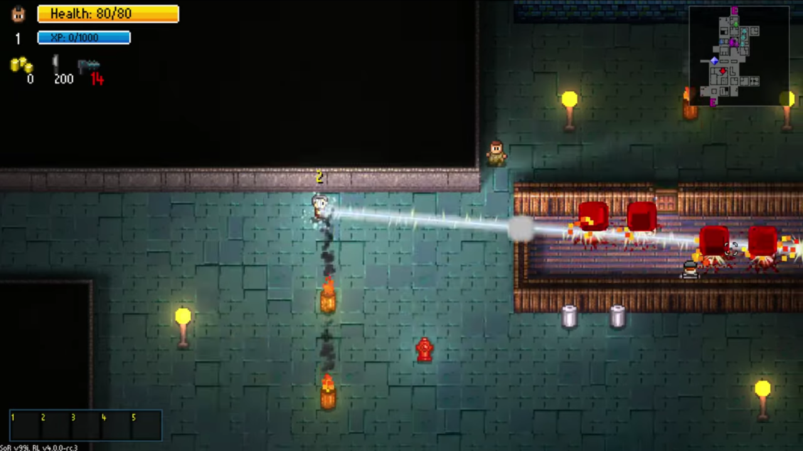

# SoR Characters: the Railgunner

A mod for [Streets of Rogue](https://store.steampowered.com/app/512900/Streets_of_Rogue/) that adds a new playable character, the **Railgunner**.

[](https://www.youtube.com/watch?v=mM0oTDAWlt4)

▶ **[Watch the Railgunner in action on YouTube](https://www.youtube.com/watch?v=mM0oTDAWlt4)**

## What it is

The Railgunner does one thing, and he does it very loudly: a single charged **railshot** that kills everything in a straight line and cuts through walls on the way. Between shots he is a bit weak, so you have to plan around the charge.

**How the railshot works**

- **Charge.** Hold the special ability key. After 1 second the gun is charged, with a hum and a laser sight showing exactly where the shot will go. Let go before that and nothing happens.
- **Armed.** Once charged ("READY") you crawl along very slowly, the aim turns slowly, and you take 50% more damage. Let go to fire. If you keep holding, the shot fires on its own after 3 seconds.
- **The shot.** It is instant. Every person in the line dies, and every object and wall along the beam is destroyed. Steel walls survive unless you have the Breaching Slug upgrade. The outer edge of the map always stops it. The beam is 20 tiles long.
- **People notice.** Anyone who sees you charging or armed gets a "!" over their head, and 2 seconds later they turn hostile. The hum also draws people over to see what is going on.
- **Recharge.** 15 seconds after firing, you can charge again.

**Big quest: Line 'Em Up.** On each level, land 3 railshots that each kill at least 3 people.

**Upgrades.** At level-ups (like the game's other ability upgrades) you can be offered:

- **Supercapacitors**: the railshot recharges a third faster.
- **Breaching Slug**: the beam also cuts through steel walls.

**Starting gear.** A Knife and the Railgun item. The Railgun is a keepsake: it stays in your inventory all run, and firing is still done with the special ability. He also has a hazard-tech look: orange demolitionist suit, black mohawk, black legs, white eyes.

## Requirements

- Streets of Rogue (tested on v99i, Linux native build)
- [BepInEx 5.4.23.x](https://github.com/BepInEx/BepInEx/releases) (the 5.x series, not 6)
- [RogueLibs v4.0.0-rc.3](https://github.com/Dzhake/RogueLibs/releases/tag/v4.0.0-rc.3) from the maintained fork

## Install

### Windows

1. Download BepInEx 5.4.23.x for Windows (x64) and extract it into the game folder, so that `BepInEx` and `winhttp.dll` sit next to `StreetsOfRogue.exe`. (Find the folder with Steam: right-click the game, Manage, Browse local files.)
2. Start the game once and quit. This creates the rest of the BepInEx folders.
3. Put `RogueLibsCore.dll` into `BepInEx/plugins/`.
4. Extract the Railgunner release zip into the game folder. It lands at `BepInEx/plugins/SoRCharacters/`.
5. Start the game.

### Linux

1. Download BepInEx 5.4.23.x for Linux (x64) and extract it into the game folder, so that `BepInEx` and `run_bepinex.sh` sit next to the game's executable.
2. Make the script runnable: `chmod +x run_bepinex.sh`.
3. In Steam, right-click the game, open Properties, and set the launch option to `./run_bepinex.sh %command%`.
4. Start the game once and quit. This creates the rest of the BepInEx folders.
5. Put `RogueLibsCore.dll` into `BepInEx/plugins/`.
6. Extract the Railgunner release zip into the game folder. It lands at `BepInEx/plugins/SoRCharacters/`.
7. Start the game.

### Playing

Pick **Railgunner** from the custom characters in character select. The first time the mod runs it also saves him as a Character Creator preset, so he shows up there too.

## Configuration

Settings live in `BepInEx/config/grant.sor.characters.cfg`, created on first launch. Restart the game after editing. An invalid value falls back to its default, and a warning appears in the BepInEx log.

The main keys in the `[Railgunner]` section:

| Key | Default | What it does |
| --- | --- | --- |
| `ChargeSeconds` | 1 | Seconds to hold the key to charge |
| `ChargedSpeedMultiplier` | 0.5 | Walking speed while charging |
| `ArmedSpeedMultiplier` | 0.15 | Walking speed once charged |
| `ArmedMaxSeconds` | 3 | Seconds you can stay charged before it fires by itself |
| `AimTurnDegreesPerSecond` | 90 | How fast the aim can turn once charged |
| `ChargedDamageTakenMultiplier` | 1.5 | Damage taken while charged |
| `RechargeSeconds` | 15 | Seconds before the next charge |
| `SupercapacitorsRechargeMultiplier` | 0.6667 | Recharge time with Supercapacitors |
| `BeamWidthTiles` | 0.5 | Beam width (at most 8) |
| `BeamRangeTiles` | 20 | Beam length (at most 160) |
| `AlertSeconds` | 2 | Seconds before a witness turns hostile |
| `LineEmUpKills` | 3 | Kills one shot needs to count for the quest |
| `LineEmUpShots` | 3 | Qualifying shots needed per level |
| `ReadyToneVolume` | 0.5 | Volume of the "armed" tone |

There are more for the look and feel: `ShakeSeconds`, `ShakeOffset`, `HumIntervalSeconds`, `HumLoudAfterSeconds`, `BeamFadeSeconds`, `AfterglowSeconds`, `FlashSeconds`, `SparksPerTile`, and the game sound names `ChargeSound`, `FireSound` and `FireSound2`. Each has a description in the config file.

**ResetPresets.** In the `[Presets]` section, set `ResetPresets = true` to rewrite the Railgunner's Character Creator preset on the next start. The mod turns it back off afterwards. Your old preset file is backed up first (in `BackupData` next to your `CloudData` folder). The mod only ever touches its own preset, never your other characters. If you delete the preset on purpose, it is not recreated unless you use `ResetPresets`.

**Custom sounds.** The folder `BepInEx/plugins/SoRCharacters/sounds/` is created on first launch. Put a file named `railgun_charge` (the charge-up sound) or `railgun_fire` (the main firing sound) there, as `.wav`, `.ogg` or `.mp3`, to replace the built-in sound. Restart the game after changing files. The BepInEx log says which file was loaded.

## Known limitations

- Single-player and local co-op only. Online play is disabled for the Railgunner: the railshot does nothing and you get a one-time message.
- In co-op, the Line 'Em Up popups only show for player 1.
- Tested on Linux only so far. The Windows install steps and save-folder handling follow the game's own code but have not been played yet.
- If you save the Railgunner in the Character Creator while the mod is not loaded, the saved copy loses his ability and quest. To fix it, set `ResetPresets = true` and start the game with the mod installed.

## Building from source

You need the .NET SDK 8 or newer (the repo builds with the .NET 10 SDK) and a copy of the game with BepInEx and RogueLibs installed, since the mod compiles against them.

```
dotnet build -c Release
dotnet test tests/SoRCharacters.Core.Tests
scripts/package.sh
```

- `Directory.Build.props` sets `GameDir`, the game folder (default: the Linux Steam location). Override it with `dotnet build -c Release -p:GameDir="/path/to/Streets of Rogue"`.
- `dotnet build -c Release` also copies the plugin into the game's `BepInEx/plugins/SoRCharacters/`.
- `scripts/package.sh` builds and writes the release zip to `dist/SoRRailgunner-<version>.zip`. The version comes from `Plugin.Version` in `src/SoRCharacters/Plugin.cs`.
- The pure game-independent logic lives in `src/SoRCharacters.Core`, which is what the tests cover.
- Art and sounds are generated: `python3 art/make_icons.py` (needs Pillow) and `python3 art/make_sounds.py --resources`.
- Design notes and the playtest checklist are in `docs/`.

## Credits

- [RogueLibs](https://github.com/Dzhake/RogueLibs) by Chasmical, maintained fork by Dzhake (MIT)
- [BepInEx](https://github.com/BepInEx/BepInEx) (LGPL-2.1) and [Harmony](https://github.com/pardeike/Harmony)
- Streets of Rogue is by Matt Dabrowski / tinyBuild. This mod is not affiliated with or endorsed by them.
- The art and the "ready" tone are original, generated by the scripts in `art/`.

## License

MIT. See [LICENSE](LICENSE).
